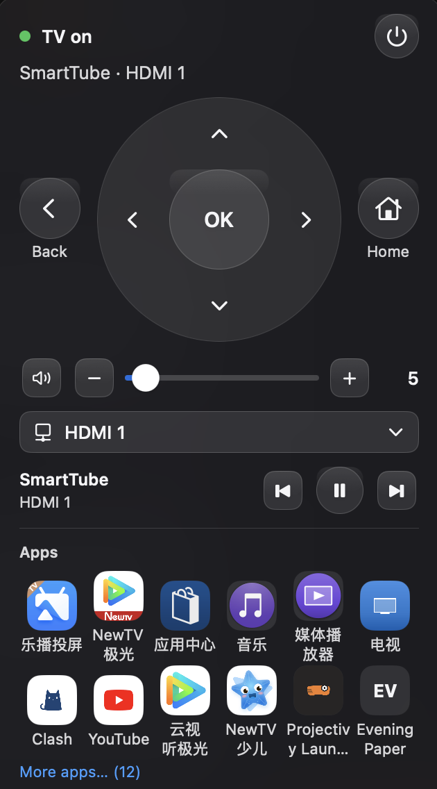

<p align="center"></p>

# Zapbar

A macOS menu bar remote for your TV: D-pad, app tiles, inputs, volume, power, and typing on the TV.

Zapbar was called Mac Android TV Remote up to v1.0.1. Same project, new name.

## Install

1. Download `Zapbar-1.1.1.zip` (or `Zapbar-1.1.1.dmg`) from the [latest release](https://github.com/pohstep/mac-android-tv-remote/releases/latest).
2. Move **Zapbar** to Applications and open it. It is not signed with an Apple developer account, so macOS asks first. See [First launch](#first-launch-unsigned-app).
3. Follow the setup window, or use **Try demo TV** to look around without a TV.

## What it can't do yet

- Tested first on a Sony Bravia (Google TV / Android TV). Other brands are unverified.
- Typing, screenshots, and installing an app need this Mac allowed on the TV. The TV asks once. The release app includes its own connection helper.
- Typing is English only. No Chinese input.
- Mac only, macOS 13 or later.




## Features

- **D-pad, OK, Back, Home**, play/pause, previous/next.
- **Volume** slider, steps and mute.
- **App tiles** with names, and the TV's own icon where the TV provides one, with **More apps…** for the rest of the list.
- **Inputs** with the names the TV reports.
- **Power** is one button. The label follows the TV: **Turn off** when it is on, **Turn on** when it is off or still unknown. While Zapbar is checking, the button says **Checking…**. Turn on and Turn off try the other ways on their own. The button does not name those ways.
- **Several TVs.** The last one reconnects on launch. Power is in the menu bar. Release and sandbox builds leave a v1.0 settings file and the old keychain item unread, so the first launch does not ask for Keychain access. `scripts/build-dev.sh` sets `ZAPBAR_MIGRATE_V1` and can bring that TV and key across.
- **Setup** walks through brand, finding the TV (or typing an address), debugging, pairing or Allow, and saving.
- **Type on the TV.** A field in the panel sends on Return, including a pasted URL as plain text. Cut, Copy, Paste, and Select All are on the Edit menu, and Command-V still works while keyboard-as-remote is on. `⌃⌥T` opens the panel and focuses the field. If no text field is focused on the TV, the text stays and **Retry** sends it again. A drop adds to the field. An empty send asks you to type something.
- **Try demo TV** opens a connected panel with no TV on the network. It is on the find step when nothing is found, and in Settings. Leave demo returns to a saved TV. Demo mode is not saved.
- **Screenshot** copies the TV picture to the clipboard or saves it. **Save…** starts in Desktop, or Pictures if Desktop is not there, with the name `Zapbar Screenshot YYYY-MM-DD at HH.mm.ss.png`. The lines are "Saved" and "Couldn't save". A black picture is kept, and the panel says the TV may block screenshots of protected video.
- **Install an app** by dropping an .apk on the panel or the menu bar icon, or with **Choose .apk…**. Other files are refused. The panel shows Installing, then Installed or the reason it failed, and a log you can open and copy. Filenames can contain spaces.
- **Launch at login** is a switch in Settings. It is on only when macOS says the login item is enabled. If macOS needs approval, the switch stays off and **Open Login Items** is offered.
- **Keyboard as remote** in the non-sandbox build: `⌃⌥K` toggles it, `⌃⌥⌘K` turns it off. The sandboxed build hides this. It needs Accessibility, which the sandbox does not grant.

Clean-up with undo is built behind an Advanced section and is excluded from the release build until Jim says go. `scripts/build-local.sh` leaves `ZAPBAR_ADVANCED` off, so the release app has no clean-up code. `scripts/build-dev.sh` turns it on. `swift test` still covers it.

Xiaomi control (remote buttons, apps, and HDMI) is **experimental**. It was checked with a stand-in on this Mac, not a real set. It cannot type and cannot turn the set on.

## Requirements

- macOS 13 Ventura or later (Intel or Apple silicon).
- A TV on the same network. A Sony needs network control turned on (see Setup) and a control key. Other sets need this Mac allowed on the TV.
- A sandboxed build needs a local copy of the connection helper on the build machine. See [docs/adb-notice.md](docs/adb-notice.md). The app never downloads it.

## Setup

### On a Sony TV

1. **Settings → Network → IP control**. Turn on control from the network, set a control key, and enter the same key in Zapbar.
2. **Remote start**: **On**, if you want the set to wake from standby.
3. Optional, for typing: allow this Mac on the TV and accept the prompt the first time it connects. Skip this if you only want the remote buttons.

### On another TV

1. Open the setup window and pick **Other TV**.
2. When the TV shows a number and a 6-digit code, enter both. Zapbar then connects.
3. On an older set, accept **Allow** on the TV.

You can always type the TV address instead of waiting for discovery.

### On the Mac

1. Open Zapbar. It lives in the menu bar and has no Dock icon.
2. The first launch with no saved TV opens setup. You can also use the menu bar item **Add a TV…** or **Settings…** (⌘,).
3. The Sony control key is stored in the login keychain, one item per TV. The first time, macOS asks to let the app use it: enter your Mac password and click **Always Allow**.
4. Keyboard-as-remote (non-sandbox builds only) needs **System Settings → Privacy & Security → Accessibility**.

## First launch (unsigned app)

Zapbar is ad-hoc signed (not notarized), so Gatekeeper blocks it the first time with a message like *“Apple cannot check it for malicious software.”* Allow it once (same pattern as other unsigned Mac apps):

1. **Right-click → Open** (macOS 13 / 14): in Finder, right-click **Zapbar** → **Open** → **Open** again in the dialog.
2. **Open Anyway** (macOS 15+): try to open it, then **System Settings → Privacy & Security** → **Open Anyway**.
3. **Or clear quarantine in Terminal:**

  ```sh
  xattr -dr com.apple.quarantine "/Applications/Zapbar.app"
  ```

## Build from source

No Xcode needed: the Command Line Tools (`swiftc`) are enough.

```sh
git clone https://github.com/pohstep/mac-android-tv-remote.git
cd mac-android-tv-remote
scripts/build-local.sh            # builds, signs, installs to ~/Applications and launches
```

Options (environment variables):

| Variable | Default | Meaning |
|---|---|---|
| `SIGN_IDENTITY` | `-` (ad-hoc) | codesign identity. A stable self-signed identity keeps the Accessibility grant across rebuilds. |
| `APP_NAME` | `Zapbar` | App bundle name |
| `BUNDLE_ID` | `com.pohstep.tvremote` | Bundle identifier |
| `INSTALL_DIR` | `~/Applications` | Install location |
| `NO_INSTALL=1` | – | Build and sign only |
| `SANDBOX=1` | – | Sandboxed build with a bundled `adb` |
| `PLATFORM_TOOLS` | `./platform-tools` | Local platform-tools directory used when `SANDBOX=1` |
| `ADB_BINARY` | `$PLATFORM_TOOLS/adb` | `adb` to embed |

### Sandboxed build

Put an unzipped platform-tools folder on the Mac (do not commit it). It must contain `adb` and `NOTICE.txt` or `NOTICE`. The script copies both into the bundle and signs them. It will not fetch `adb`.

```sh
SANDBOX=1 NO_INSTALL=1 scripts/build-local.sh
```

With an explicit directory and a signing identity:

```sh
SANDBOX=1 PLATFORM_TOOLS="$HOME/platform-tools" SIGN_IDENTITY="-" NO_INSTALL=1 scripts/build-local.sh
```

The host is signed with `macos/PohstepRemote/Zapbar.entitlements` (`app-sandbox`, `network.client`, `network.server`) and the hardened runtime. The helper at `Contents/Helpers/adb` is signed with `macos/PohstepRemote/adb-helper.entitlements` (`app-sandbox` and `inherit` only) and the hardened runtime. Every `adb` launch sets `TMPDIR` to the app temporary directory. A sandboxed build sets `ADB_SERVER_SOCKET` to `tcp:localhost:5038` and passes `-P 5038`, so the helper starts its own server. The other build uses `tcp:localhost:5037` and `-P 5037`. The non-sandbox build still looks for a user-installed `adb` when the helper is absent.

See [docs/adb-notice.md](docs/adb-notice.md) for the Apache-2.0 notice.

CI: a GitHub Actions workflow is included as `docs/ci/build.yml.example`. To enable it, copy it to `.github/workflows/build.yml`.

> With ad-hoc or self-signed builds (no Apple Team ID), macOS ties keychain access to each build's hash. So after every rebuild, the keychain asks once more; click **Always Allow**.

## Privacy

Everything stays on your local network. The app talks only to your TVs. There is no analytics, telemetry, or cloud. Control keys live in the macOS keychain, and typed characters are never logged.

## License

[MIT](LICENSE) © pohstep

The bundled `adb` binary, when you build with `SANDBOX=1`, is Apache License 2.0 and is not covered by the MIT license. Its notice is copied into the app. See [docs/adb-notice.md](docs/adb-notice.md).
